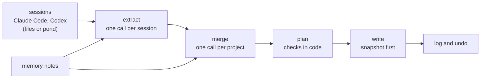

# ai-dreamcatcher

Your coding agents forget, repeat themselves and keep stale facts. `dreamcatcher` cleans their memory while you sleep.

Once an hour it reads the sessions your agents finished, then rewrites the Claude Code memory of that project: duplicates merged, corrected values replaced, new facts added. Every change cites the session it came from, shows up in a digest, and can be undone byte for byte for 30 days.

It works like Anthropic's Dreaming, but it runs on its own, locally, on any Claude Code project, and also reads Codex sessions.



## Install

```sh
cargo install --path .
dreamcatcher init            # writes config, runs one small test call, prints the launchd entry
dreamcatcher run --dry-run   # shows what it would change, writes nothing
```

`init` installs nothing. Save the printed plist to `~/Library/LaunchAgents/` and load it to run hourly. Needs macOS, the `claude` CLI, and optionally `pond` as the session source.

## Use

| Command | Does |
|---|---|
| `run [--dry-run]` | One tick: picks due projects, dreams, applies. |
| `status` | Projects, pending sessions, skips and drops. |
| `log [<run>]` | Every applied change with its sources, plus the undo command. |
| `undo <run>` | Puts back every note nobody edited since. |
| `retry <ref>` | Clears the strikes of a session that kept failing. |
| `smoke` | One tiny call, to check the `claude` CLI works unattended. |

## Safety

- **The model has no tools.** It gets text and returns JSON. Code checks every change before anything is written.
- **Nothing is lost.** Each run snapshots what it changes. A crash is rolled back on the next start, and `undo` never overwrites a note you edited since.
- **Bounded.** At most 10 changes and 2 deletes per project run. A larger output is thrown away.
- **No secrets written.** Transcripts are redacted before any call, and changes that add secret-looking or hidden text are dropped.
- **Local.** The tool opens no network connection. Text goes only to the `claude` CLI, and Codex text only for projects you opt in.

Text planted in a session, for example on a web page an agent read, can still steer a dream. The answer is `log` and `undo`, so read the digest.

## Status

v0.1. The automated acceptance criteria pass, and the live eval passes 11 of 11 cases in 3 rounds. Two checks need real use: a run with the screen locked, and a human read of 20 applied changes. The design and its open questions are in [docs/design.md](docs/design.md).
